<div align="center">

# 🐾 DogLens

### Discover dog breeds through images

An Android app for identifying dog breeds, exploring breed profiles and articles, and saving discoveries.

</div>

## Features

- **Photo recognition** uses CameraX or the Android photo picker. Users can crop and rotate an image before recognition, review confidence and breed information, and download or share the result.
- **Breed discovery** includes search, size categories, featured topics, working roles, similar breeds, and saved favorites.
- **Articles** include a searchable library, list and cover layouts, bookmarks, and reading history.
- **Account and activity** include Firebase sign-in, account settings, recognition history, notifications, and a Premium checkout entry point.

## App screenshots

Captured from a local DogLens build on an Android emulator. Click a screenshot to open it at full size.

### Home and breed discovery

| Home | Explore | Breed search |
| --- | --- | --- |
| <a href="screenshots/home.webp">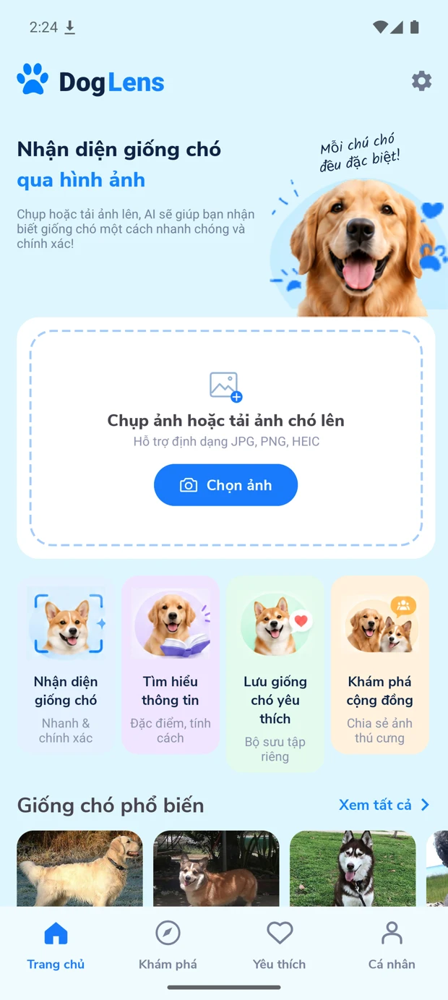</a> | <a href="screenshots/explore.webp"></a> | <a href="screenshots/breed-search.webp">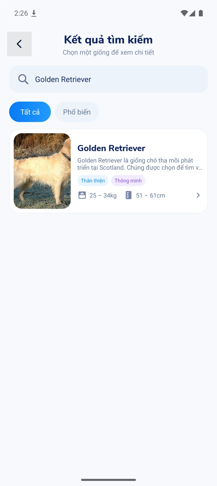</a> |

| Categories | Featured topics | Working roles |
| --- | --- | --- |
| <a href="screenshots/explore-categories.webp"></a> | <a href="screenshots/explore-topics.webp">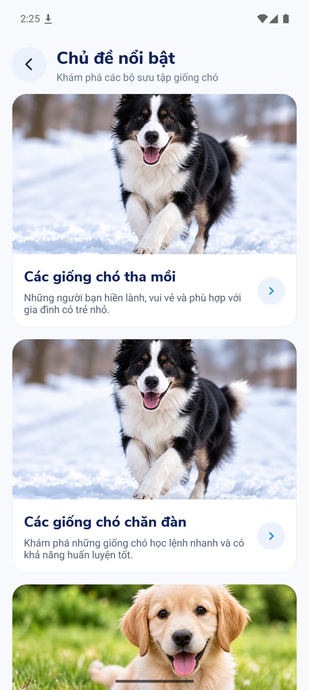</a> | <a href="screenshots/explore-roles.webp">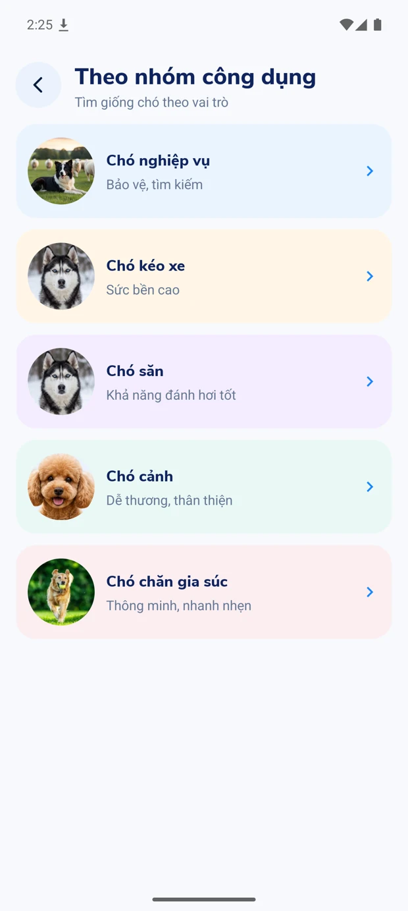</a> |

| Breed profile | Similar breeds | Favorites |
| --- | --- | --- |
| <a href="screenshots/breed-detail.webp"></a> | <a href="screenshots/similar-breeds.webp">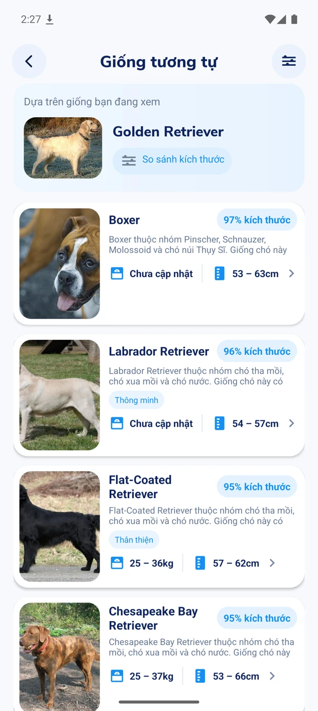</a> | <a href="screenshots/favorites.webp">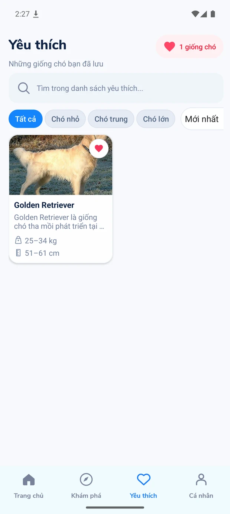</a> |

### Photo recognition

| Choose an image source | In-app camera | Crop and rotate |
| --- | --- | --- |
| <a href="screenshots/image-source.webp"></a> | <a href="screenshots/camera.webp"></a> | <a href="screenshots/image-preview.webp"></a> |

| Recognition in progress | Breed result | Unrecognized camera photo |
| --- | --- | --- |
| <a href="screenshots/recognition-progress.webp"></a> | <a href="screenshots/recognition-result.webp"></a> | <a href="screenshots/recognition-no-dog.webp"></a> |

| Recognition history | Notifications |
| --- | --- |
| <a href="screenshots/recognition-history.webp">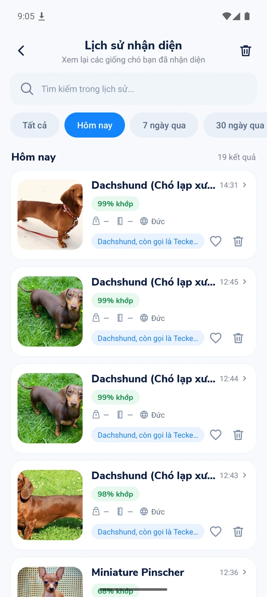</a> | <a href="screenshots/notifications.webp">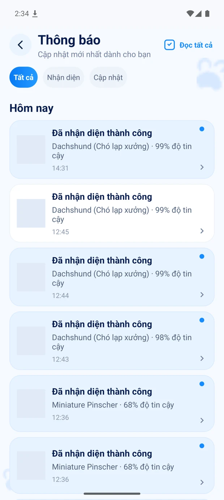</a> |

### Article library

| Article list | Cover layout | Article detail |
| --- | --- | --- |
| <a href="screenshots/articles-cards.webp"></a> | <a href="screenshots/articles.webp">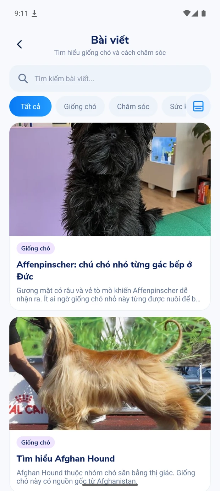</a> | <a href="screenshots/article-detail.webp">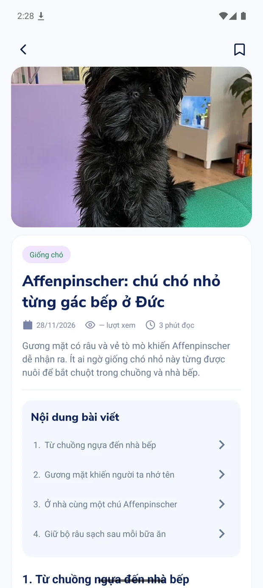</a> |

| Article sections | Reading history |
| --- | --- |
| <a href="screenshots/article-contents.webp">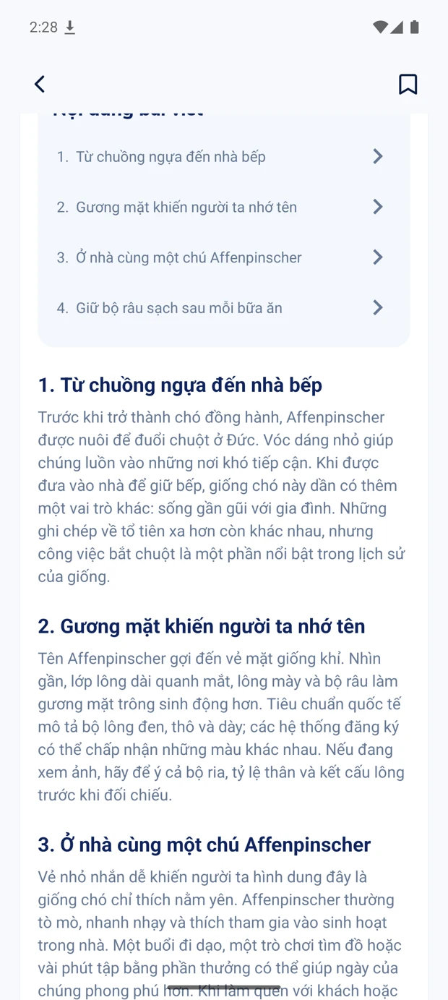</a> | <a href="screenshots/viewed-articles.webp"></a> |

### Accounts, settings and Premium

| Guest profile | Sign in | Create account |
| --- | --- | --- |
| <a href="screenshots/guest-profile.webp"></a> | <a href="screenshots/login.webp"></a> | <a href="screenshots/register.webp"></a> |

| Reset password | Signed-in profile | Edit profile |
| --- | --- | --- |
| <a href="screenshots/forgot-password.webp">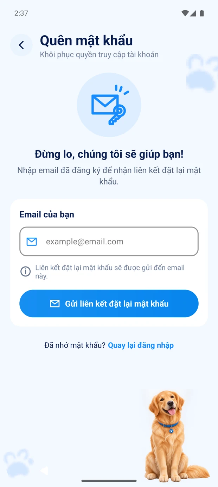</a> | <a href="screenshots/profile.webp"></a> | <a href="screenshots/edit-profile.webp"></a> |

| Settings | Change password | Premium plans |
| --- | --- | --- |
| <a href="screenshots/settings.webp"></a> | <a href="screenshots/change-password.webp">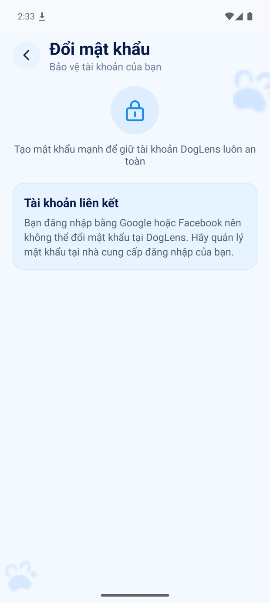</a> | <a href="screenshots/premium.webp">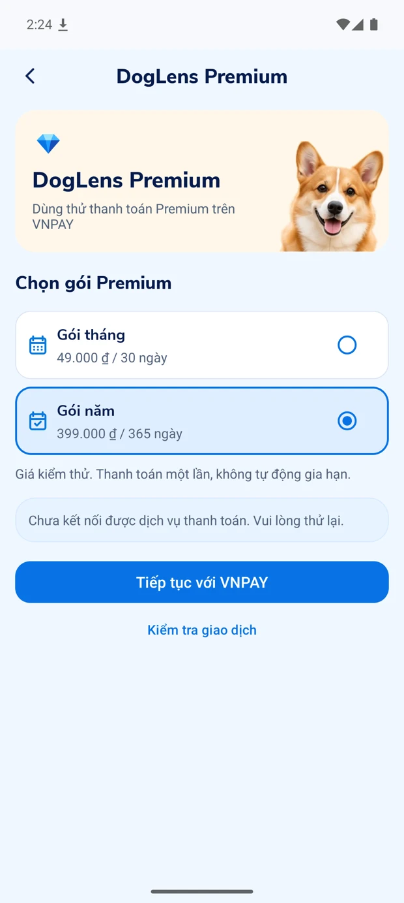</a> |

| Checkout confirmation |
| --- |
| <a href="screenshots/premium-confirmation.webp">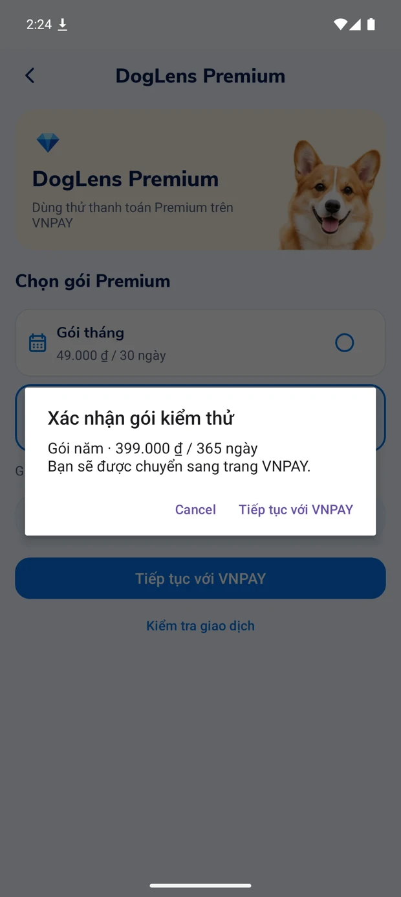</a> |

## Tech stack

| Area | Technology |
| --- | --- |
| Android | Kotlin, XML layouts, Fragments, RecyclerView, CameraX |
| State and asynchronous work | ViewModel, StateFlow, Kotlin Coroutines |
| Catalog and account data | Firebase Authentication, Cloud Firestore |
| Recognition | ONNX Runtime on device, optional recognition backend |
| Payments | Firebase Cloud Functions and VNPAY |

## Run locally

1. Clone the repository and open it in Android Studio.

   ```bash
   git clone https://github.com/VuIceTea/DogLens.git
   ```

2. Add the Firebase Android configuration at `app/google-services.json` for the `com.example.doglens` application ID. Enable the authentication providers you intend to test and configure Firestore. The Android configuration is project-specific.
3. Sync Gradle and run the app on an emulator or an Android device. The minimum Android version is Android 7.0 (API 24).
4. To connect the optional recognition service, follow the [recognition backend setup](recognition_backend/README.md) and set `DOG_RECOGNITION_API_URL` as a Gradle property.

Premium checkout requires separate VNPAY sandbox and Firebase Functions configuration.
