<div align="center">
  <h1>🐾 DogLens - Dog Breed Recognition</h1>
  <p><em>A native Android app for identifying dog breeds from photos and learning more about them.</em></p>

  [](https://developer.android.com/)
  [](https://kotlinlang.org/)
  [](https://firebase.google.com/)
</div>

## 📋 Project Overview

**DogLens** lets users take or import a photo, identify a candidate dog breed, and explore its traits and care information. The app brings breed profiles, related articles, favorites, and identification history together in one Android interface.

### 🎯 Project Goals

- Make photo-based breed identification easy from camera capture to result.
- Provide a searchable catalog with breed comparisons and care articles.
- Help users revisit breeds, recognition results, and articles they have saved or viewed.

## ✨ Key Features

### 📷 Photo Recognition

- Capture a photo in the app or select one from the Android photo picker.
- Crop and rotate the image before running recognition.
- See the predicted breed and the model’s confidence, or get feedback when no reliable result is available.
- Download or share a recognition result and revisit it in history.

### 🦮 Breed Discovery

- Browse breeds by size, featured topic, or working role.
- Search the catalog, compare similar breeds, and save favorites.
- Read breed traits, basic measurements, and care information when available.

### 📚 Articles & Activity

- Browse articles in list or cover view, filter by category, and search by title or summary.
- Bookmark articles and revisit reading history.
- Review recognition notifications and open the associated results.

### 👤 Account & Premium

- Create or sign in to an account, request a password reset, and edit a profile.
- Manage notification preferences and account settings.
- View monthly and yearly Premium plans and open the VNPAY sandbox checkout when configured.

## 🛠️ Technology & Architecture

### Android UI

- **Kotlin** and **Android XML** for the native app.
- **Fragments**, **RecyclerView**, and **Material Components** for screens and navigation.
- **CameraX**, the **Android photo picker**, and **Glide** for image capture, selection, and rendering.

### State Management & Data

- **ViewModel**, **StateFlow**, and **Kotlin Coroutines** for UI state and asynchronous work.
- **Repositories** for catalog, article, recognition, and account operations.
- **Firebase Authentication** and **Cloud Firestore** for identity and app data.

### Recognition & Payments

- **ONNX Runtime** for on-device recognition and an optional **FastAPI** recognition service.
- **Firebase Cloud Functions** and **VNPAY Sandbox** for Premium checkout.

### Development & Testing

- **Android Studio**, the **Gradle Wrapper**, **Git**, and **Firebase CLI**.
- Android instrumentation tests for local recognition and Python API tests for the recognition service.

<a name="app-screenshots"></a>

## 📱 Application Interface

Screenshots captured from DogLens running on an Android emulator. Click an image to open it at full size.

### 🔐 Authentication & Onboarding

<div align="center">
  <a href="screenshots/guest-profile.webp">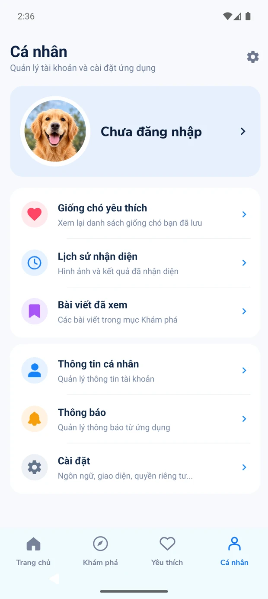</a>
  <a href="screenshots/login.webp">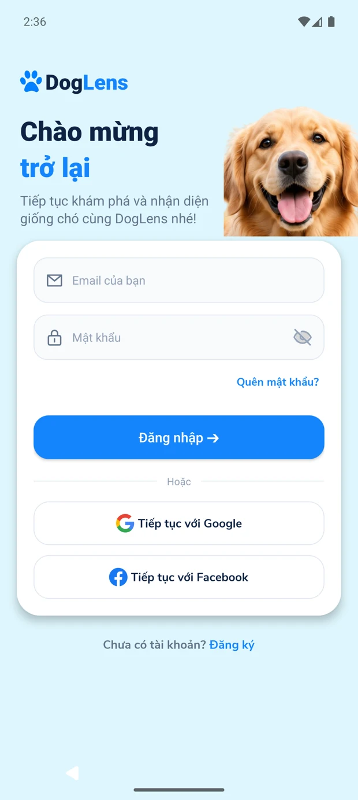</a>
  <a href="screenshots/register.webp">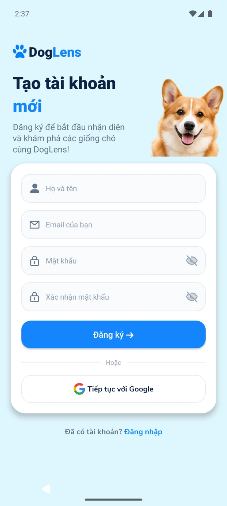</a>
  <a href="screenshots/forgot-password.webp"></a>
</div>

### 🏠 Home & Navigation

<div align="center">
  <a href="screenshots/home.webp"></a>
  <a href="screenshots/explore.webp">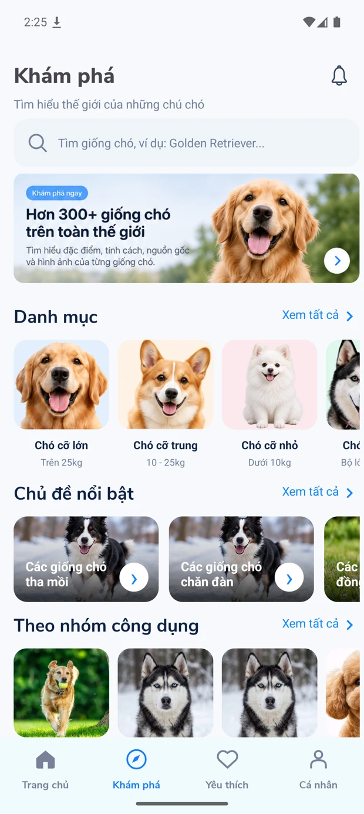</a>
  <a href="screenshots/breed-search.webp"></a>
  <a href="screenshots/favorites.webp"></a>
</div>

### 🦮 Breed Discovery

<div align="center">
  <a href="screenshots/explore-categories.webp">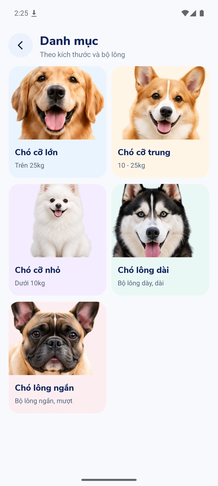</a>
  <a href="screenshots/explore-topics.webp"></a>
  <a href="screenshots/explore-roles.webp"></a>
  <a href="screenshots/breed-detail.webp">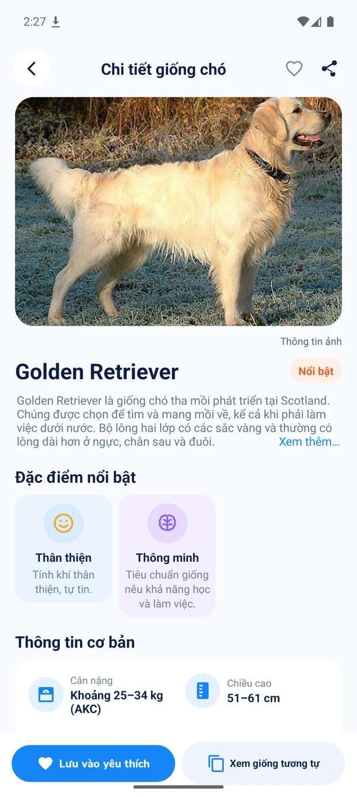</a>
</div>

<div align="center">
  <a href="screenshots/similar-breeds.webp"></a>
</div>

### 📷 Photo Recognition

<div align="center">
  <a href="screenshots/image-source.webp">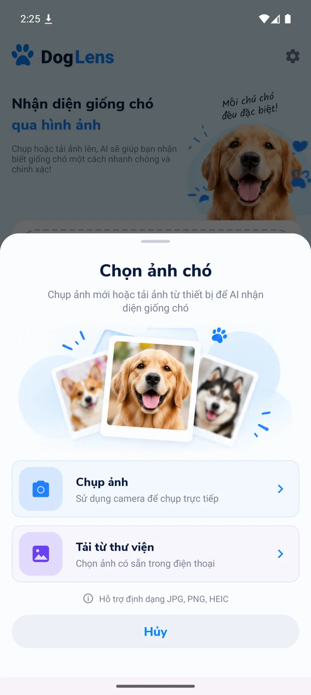</a>
  <a href="screenshots/camera.webp">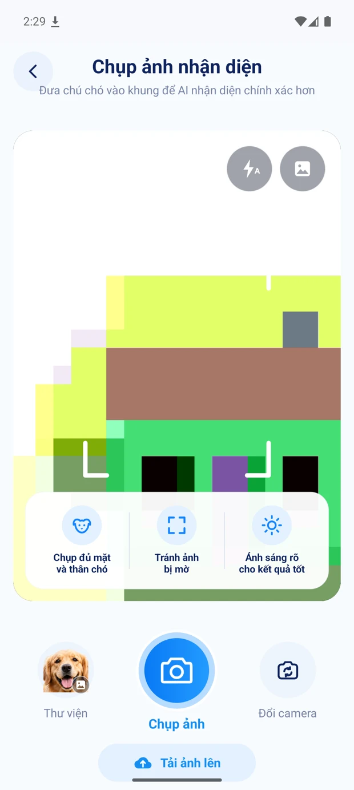</a>
  <a href="screenshots/image-preview.webp">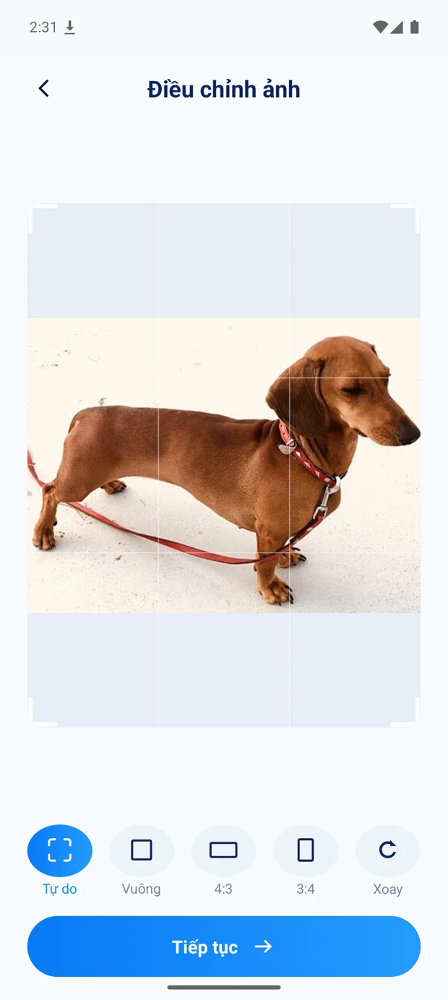</a>
  <a href="screenshots/recognition-progress.webp">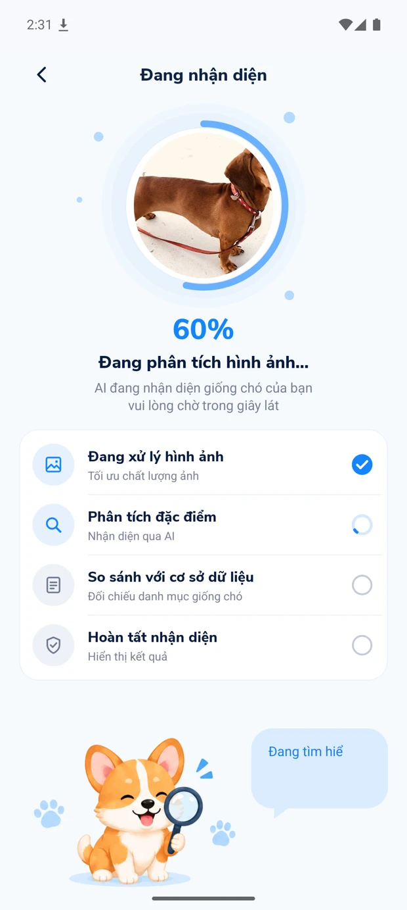</a>
</div>

<div align="center">
  <a href="screenshots/recognition-result.webp">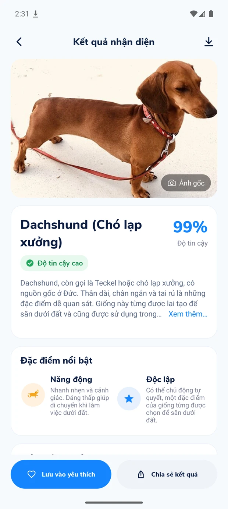</a>
  <a href="screenshots/recognition-no-dog.webp">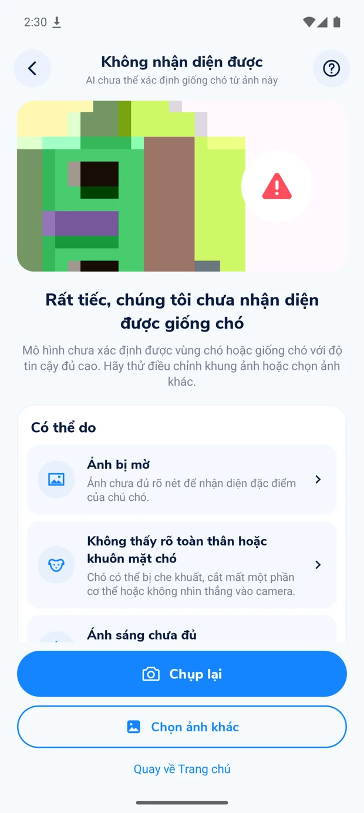</a>
  <a href="screenshots/recognition-history.webp"></a>
  <a href="screenshots/notifications.webp"></a>
</div>

### 📚 Article Library

<div align="center">
  <a href="screenshots/articles-cards.webp">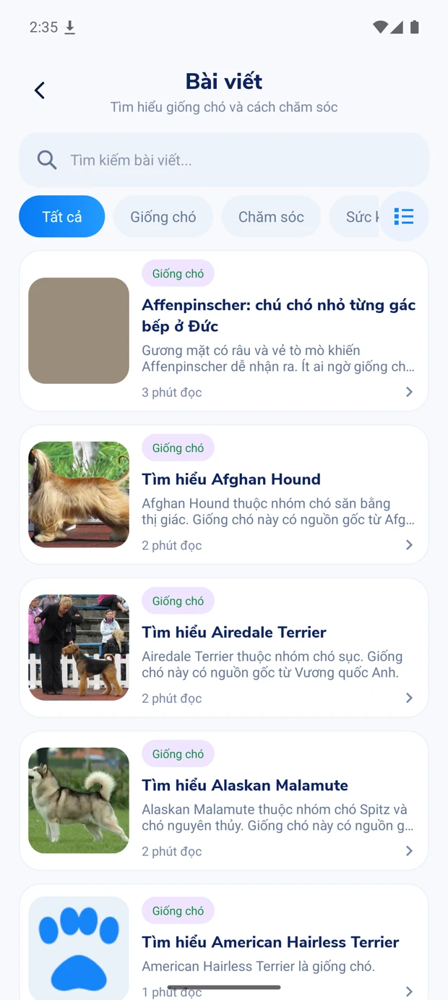</a>
  <a href="screenshots/articles.webp"></a>
  <a href="screenshots/article-detail.webp"></a>
  <a href="screenshots/article-contents.webp"></a>
</div>

<div align="center">
  <a href="screenshots/viewed-articles.webp">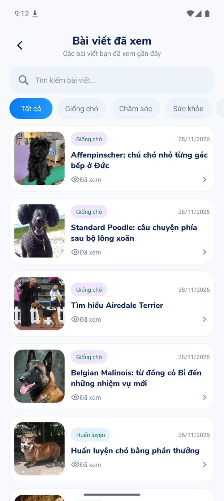</a>
</div>

### 👤 Profile & Settings

<div align="center">
  <a href="screenshots/profile.webp">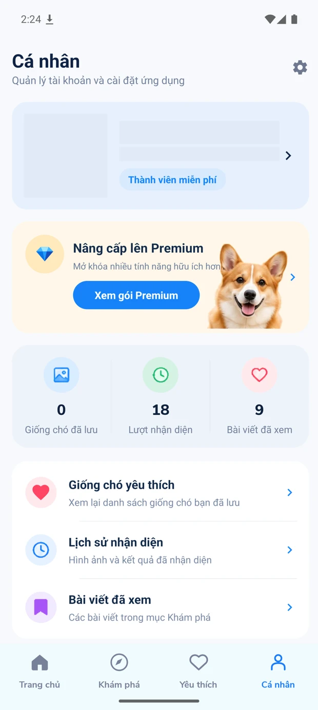</a>
  <a href="screenshots/edit-profile.webp">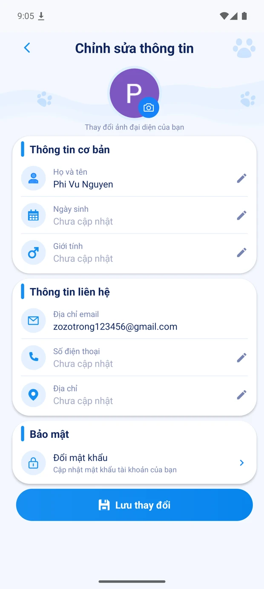</a>
  <a href="screenshots/settings.webp">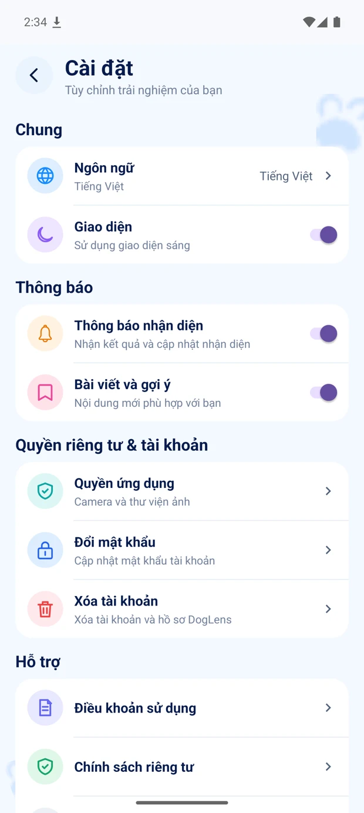</a>
  <a href="screenshots/change-password.webp"></a>
</div>

### 💎 Premium Checkout

<div align="center">
  <a href="screenshots/premium.webp"></a>
  <a href="screenshots/premium-confirmation.webp"></a>
</div>

## 🚀 Getting Started

### 📋 System Requirements

- Android Studio with Android SDK 37 for compiling the app
- An Android emulator or device running Android 7.0 (API 24) or later
- A Firebase project for Authentication and Cloud Firestore
- Git

### 🛠️ Installation & Setup

#### 1. Clone the repository

```bash
git clone https://github.com/VuIceTea/DogLens.git
cd DogLens
```

#### 2. Configure Firebase

Register the Android app with package name `com.example.doglens` and place the Firebase configuration file at `app/google-services.json`. Enable the sign-in providers you use and configure Cloud Firestore using the repository’s `firestore.rules`.

#### 3. Build and run

Open the project in Android Studio, let Gradle Sync finish, select a device, and run the `app` configuration. Use the following PowerShell command to build a debug APK.

```powershell
.\gradlew.bat :app:assembleDebug
```

#### 4. Configure optional services

- **Recognition API** — Set the Gradle property `DOG_RECOGNITION_API_URL` when using the optional service. [Recognition backend setup](recognition_backend/README.md)
- **Premium** — Configure the VNPAY sandbox credentials on Firebase Cloud Functions for payment testing.

## 📁 Project Structure

```text
DogLens/
├── app/
│   └── src/
│       ├── main/
│       │   ├── java/com/example/doglens/
│       │   │   ├── ui/          # Screens and ViewModels
│       │   │   ├── data/        # Models, repositories, and data sources
│       │   │   └── utils/       # Shared Android utilities
│       │   ├── assets/          # Recognition models and bundled content
│       │   └── res/             # Layouts, drawables, fonts, and strings
│       ├── test/                # Local unit tests
│       └── androidTest/         # Android instrumentation tests
├── functions/                  # Firebase Functions and catalog tooling
├── recognition_backend/        # Optional recognition API
├── screenshots/                # Android screenshots used in this README
└── firestore.rules             # Firestore access rules
```

## 👨‍💻 Author

**Nguyen Phi Vu** - *Android Developer*

- 🐙 GitHub: [@VuIceTea](https://github.com/VuIceTea)
- 📧 Email: [phivu20030411@gmail.com](mailto:phivu20030411@gmail.com)
- 💼 LinkedIn: [Nguyen Phi Vu](https://www.linkedin.com/in/phi-vu-nguyen-8a18a5371/)
- 🌐 Portfolio: [**https://vuicetea.github.io/**](https://vuicetea.github.io/)
